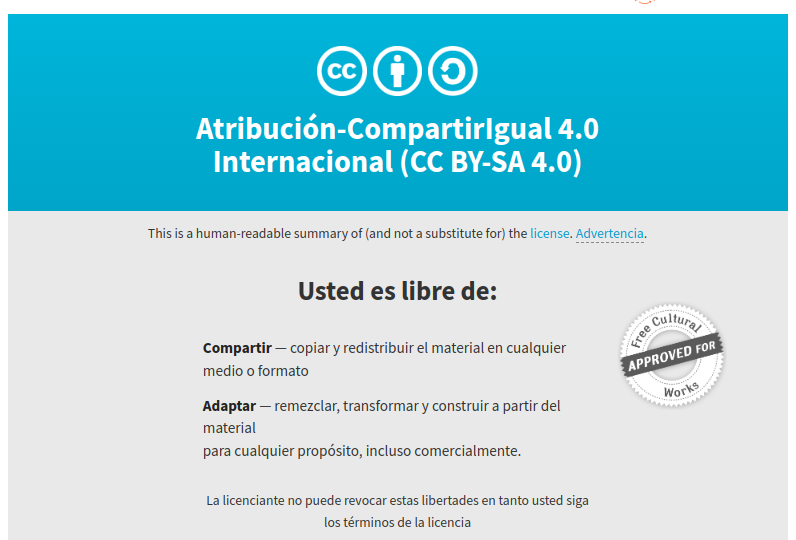

# Fundamentos de TI: Un recorrido por las excentricidades de un entorno de TI

**Segunda Edición (2026)** — Revisada, actualizada y expandida  
**Autor:** Jesús A. Palencia S. (`sinfallas@gmail.com`)  
**Licencia:** [Creative Commons Atribución-CompartirIgual 4.0 Internacional (CC BY-SA 4.0)](LICENSE)



---

## Sobre la obra

Lo que nació en octubre de 2022 como un recorrido breve de 39 páginas sobre cómo se organiza realmente un departamento de sistemas evoluciona en esta **Segunda Edición (2026)** hacia una obra de referencia práctica de trinchera (~52.200 palabras / **134 páginas** en formato nativo LibreOffice Writer `.odt`), desarrollada íntegramente bajo arquitectura abierta ***Books as Code***.

Lejos del tono enciclopédico y de los folletos comerciales de proveedores, cada capítulo somete las áreas, roles y metodologías modernas de TI a cuatro preguntas operativas:
1. **El concepto sin humo:** qué problema real de negocio o continuidad resuelve.
2. **La teoría vs. la trinchera:** cómo contrasta la escala de las grandes tecnológicas (*Big Tech*) frente a la realidad cotidiana de empresas medianas y PyMEs hispanoamericanas.
3. **Excentricidades y antipatrones:** vicios reales de directivas no técnicas y de los propios informáticos, junto con señales de alerta temprana.
4. **Marco de acción pragmático:** métricas honestas, estándares abiertos, herramientas libres probadas y pasos ordenados de adopción sin detener la operación.

---

## Índice de Contenidos (`manuscrito/`)

- **Preliminares** — [Créditos CC BY-SA 4.0, Dedicatoria y Prefacio a la Segunda Edición (2026)](manuscrito/00-preliminares.md)

### Parte I — El Entorno de TI en 2026: Cultura, Negocio y Fricciones
1. [El choque de idiomas entre Negocio y TI](manuscrito/01-choque-idiomas-negocio-ti.md)
2. [Deuda técnica, obsolescencia y el síndrome del último artilugio](manuscrito/02-deuda-tecnica-obsolescencia-modas.md)
3. [Del BYOD improvisado al trabajo híbrido y remoto seguro](manuscrito/03-trabajo-hibrido-byod-frontera-diluida.md)
4. [De la fiebre Cloud/FAANG a la era de la IA y la infraestructura híbrida](manuscrito/04-de-era-faang-cloud-a-ia-hibrida.md)

### Parte II — Anatomía, Gobierno y Liderazgo de un Departamento de TI
5. [Anatomía real de un Departamento de TI: 8 dominios, CIO y *Two-Pizza Teams*](manuscrito/05-anatomia-departamento-ti-y-equipos.md)
6. [Ciberseguridad Operativa (CISO y SecOps): Defender la trinchera en tiempo real](manuscrito/06-ciberseguridad-operativa-secops-ciso.md)
7. [Riesgos, Cumplimiento, Privacidad y Auditoría (GRC, Auditor TI y DPO)](manuscrito/07-gobierno-riesgos-cumplimiento-auditoria.md)
8. [Aplicaciones Empresariales (BRM/ERP) y FinOps: Hablar el idioma del dinero](manuscrito/08-aplicaciones-empresariales-brm-finops.md)
9. [Service Desk e ITIL 4 pragmático: El fin de la informalidad y el "amiguismo"](manuscrito/09-service-desk-itil4-pragmatico.md)
10. [Redes y Comunicaciones: La plomería invisible que sostiene todo](manuscrito/10-redes-comunicaciones-conectividad.md)
11. [Sistemas e Infraestructura: Nube pública vs. virtualización *on-premise* y repatriación](manuscrito/11-sistemas-infraestructura-nube-repatriacion.md)
12. [Gestión de Proyectos y Estrategia de Servicios: Hacer que las cosas terminen](manuscrito/12-gestion-proyectos-estrategia-servicios.md)
13. [Arquitectura de Software y Desarrollo: Gobernar la complejidad](manuscrito/13-arquitectura-software-desarrollo.md)

### Parte III — Metodologías Operativas Modernas
14. [DevOps y Platform Engineering: Del eslogan a la ingeniería de entrega](manuscrito/14-devops-platform-engineering.md)
15. [DevSecOps en la práctica: Seguridad integrada sin paralizar despliegues](manuscrito/15-devsecops-en-la-practica.md)
16. [De MLOps a LLMOps e IA Agéntica: Gobernanza, datos y realidad económica](manuscrito/16-mlops-llmops-ia-agentica.md)
17. [SRE (*Site Reliability Engineering*) y Observabilidad Moderna](manuscrito/17-sre-observabilidad-moderna.md)

### Parte IV — Crónicas de Trincheras, Antipatrones y Supervivencia
18. [Crónicas de trinchera y cultura de *post-mortems* sin culpa](manuscrito/18-cronicas-trinchera-postmortems.md)
19. [Cómo defender presupuestos de infraestructura y ciberseguridad ante gerencias escépticas](manuscrito/19-defender-presupuestos-ti-ciberseguridad.md)
20. [Diagnóstico rápido de supervivencia (*Checklists*) y Epílogo 2026](manuscrito/20-diagnostico-rapido-checklists-epilogo.md)

### Anexo
- [Glosario Técnico Comentado (Sin Humo)](manuscrito/21-anexo-glosario-comentado.md)

---

## Arquitectura del Repositorio (*Books as Code*)

```text
.
├── manuscrito/          # 22 archivos Markdown modulares (00 a 21) de la 2.ª Edición
├── diagramas/           # Código fuente Mermaid (.mmd) y exportaciones PNG a 300 DPI
├── plantillas/          # Documento de estilos base OpenDocument (referencia.odt)
├── specs/               # Índice maestro, mapa de migración 2022->2026 y entrevistas de autor
├── fuente-2022/         # Archivo histórico íntegro de la 1.ª Edición (2022)
├── scripts/             # Ejecutor Docker sin root (editorial.sh) y motor Mermaid->PNG
├── test/                # Suite unitaria BATS con cobertura kcov >= 95 % (QA-11X)
├── Dockerfile.editorial # Imagen determinista Pandoc 3.6.4 + GNU Make + Python 3
├── Dockerfile.diagramas # Imagen determinista offline para renderizado de diagramas
├── docker-compose.qa.yml# Servicios efímeros aislados (network_mode: none, read_only, cap_drop: ALL)
└── build/               # Salida compilada (build/Fundamentos_de_TI_2ed.odt)
```

---

## Compilación y Verificación (Docker sin dependencias en el host)

Todo el flujo editorial y de aseguramiento de calidad cumple el estándar **QA-11X (Regla Cero)**: no necesitas instalar `pandoc`, `make` ni librerías gráficas en tu sistema operativo anfitrión; únicamente se requiere **Docker** con Compose v2.

```bash
# Renderiza los 16 diagramas (.mmd -> .png 300 DPI) y compila build/Fundamentos_de_TI_2ed.odt
./scripts/editorial.sh odt

# Regenera únicamente los diagramas en contenedor aislado sin red
./scripts/editorial.sh diagramas

# Ejecuta linters (ShellCheck + shfmt) y pruebas unitarias BATS + kcov (>= 95 %)
./scripts/editorial.sh qa-all

# Limpia artefactos compilados en build/
./scripts/editorial.sh clean
```

Detalles adicionales de validación y arquitectura de pruebas en [TESTING.md](TESTING.md).

---

## Licencia y Contacto

Esta obra (texto, diagramas y código editorial) se distribuye bajo la licencia **[Creative Commons Atribución-CompartirIgual 4.0 Internacional (CC BY-SA 4.0)](LICENSE)** (`SPDX-License-Identifier: CC-BY-SA-4.0`).

- **Autor:** Jesús A. Palencia S.
- **Contacto y donaciones voluntarias (PayPal):** `sinfallas@gmail.com`
