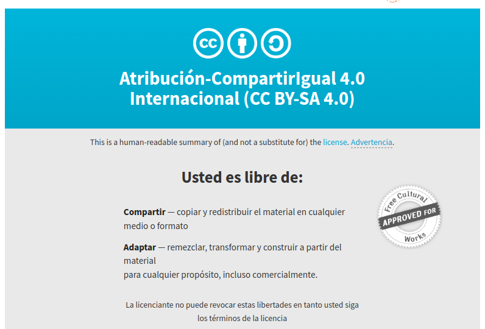

# Fundamentos de TI: Un recorrido por las excentricidades de un entorno de TI

**Autor:** Jesús A. Palencia S.  
**Licencia:** CC BY-SA 4.0  
**Edición:** Primera edición. 2022 (39 páginas)

## TABLA DE CONTENIDO

- Tabla de Contenido.
- Licencia.
- Prefacio.
- Parte I – Introducción.
- Capitulo I. Definiciones.
- Capitulo II. Aclaraciones.
- Parte II – Principios.
- Capitulo III. Estructura de un departamento de TI.
- Capitulo IV. Lideres de Área. (ese gran desconocido)
- Parte III - Metodologías de Trabajo.
- Capitulo V. DevOps, DevSecOps, MLOps, SRE
- Conclusiones

## Licencia

Donaciones por Paypal: sinfallas@gmail.com

## PREFACIO

Mi nombre es **Jesús Palencia** he sido informático por mas tiempo que cualquier otro aspecto de mi vida (estudiante, padre, amigo, etc.), soy informático de profesión y excéntrico por convicción, paso mis días tratando de entender el mundo a mi alrededor a través de un computador, aunque a veces creo que el computador es el que vive a través de mi.

Durante mucho tiempo (mas del que me gustaría aceptar) he visto el ir y venir de todo tipo de tecnologías, metodologías e implementaciones que han afectado no solo la forma en la que las empresas venden sus productos sino como se definen a si mismas. También he visto como la tecnología ha introducido cambios en nuestra vida diaria en donde las empresas mediante la obsolescencia programada nos han llevado a querer tener el ultimo artilugio de moda cambiando de forma permanente como interactúan las personas entre si, sino también con su ambiente de trabajo comenzando por la política del BYOD (Bring your own device) hasta el trabajo remoto o teletrabajo como se le conoce en algunos países.

Esta obra esta dedicada a todas aquellas personas que se encuentran dentro un departamento de TI y quieren conocer un poco mas sobre las excentricidades de nuestro entorno.

# Parte I — Introducción

## Capitulo I. Definiciones

- **T.I.**: El termino Tecnologías de la información fue creado con el propósito de hacer una distinción entre las máquinas de alcance limitado y otras con propósitos más generales. Se basa en el estudio y desarrollo de sistemas como aplicaciones software y hardware de computadoras. También puede observarse como IT.
- **ERP**: El término ERP, o software ERP, se refiere a **Enterprise Resource Planning**, que significa “sistema de planificación de recursos empresariales”. Estos programas se hacen cargo de distintas operaciones internas de una empresa, desde producción a distribución o incluso recursos humanos.
- **CIO**: Chief Information Officer
- **TWO-PIZZA Teams**: “Tratamos de crear equipos que no sean más grandes de los que se puedan alimentar con dos pizzas” Jeff Bezos,
- **Auditoría Informática**: Es un análisis crítico que se realiza a los sistemas de información de una empresa que busca evaluar la eficiencia de la misma. La informática ayuda a las empresas a tomar decisiones y gestionar sus negocios con el fin de obtener beneficios pero deben cumplir ciertas normas y estándares marcados.
- **RGPD**: Reglamento general de protección de datos.
- **Docker**: Es una plataforma de software que le permite crear, probar e implementar aplicaciones rápidamente. Docker empaqueta software en unidades estandarizadas llamadas contenedores que incluyen todo lo necesario para que el software se ejecute.
- **Kubernetes**: Es una plataforma portable y extensible de código abierto para administrar cargas de trabajo y servicios. Kubernetes facilita la automatización y la configuración declarativa.
- **BYOD**: Trae tu propio dispositivo, en inglés.
- **FAANG**: Facebook, Apple, Amazon, Netflix, Google.

## Capitulo II. Aclaraciones

Muchos de los conceptos expuestos aquí se basan en mi experiencia y en material de dominio publico que ha sido publicado a los largo de los años por múltiples autores y empresas que tratan de explicar un poco los nuevos fenómenos en la interacción humana y empresarial creados por la tecnología.

Los conceptos han variado a los largo de los años y algunos de ellos pueden incluso parecer que chocan o crean conflictos con otras definiciones, quedando en ultima instancia el criterio de aquellos que definen el papel de la tecnología en su organización y su propia idea de que es una empresa y que debe lograr durante su existencia.

Habiendo hablado suficiente de términos y definiciones entremos ahora de lleno en como debe ser un departamento de TI y como algunas empresas lo definen a su propia manera.

# Parte II — Principios

## Capitulo III. Estructura de un departamento de TI

Empezamos con esta cita de **Kurt Lewin**:

> “Si usted realmente quiere entender algo, trate de cambiarlo.”

No existe el organigrama perfecto para un departamento de TI ya que este siempre cambia, debe ser fluido y tan plano como sea posible; es mas una estructura organizacional funcional no es un fin, es el medio, que correctamente aplicado podría resolver la mayoría de los problemas que afectan la percepción que el negocio tiene de TI.

Con frecuencia la organización ve a TI como una estructura que:

- No se integra con las necesidades del negocio porque no es ágil, es costosa y tiene recursos tecnológicos o humanos ociosos.
- Ejecuta proyectos que no finalizan a tiempo, o no finalizan.
- No es trasparente en la gestión financiera o no habla el mismo idioma que el negocio.
- No tiene la capacidad de brindar a la organización lo que necesita en el momento que lo necesita.

Mientras que la organización de TI tiene dificultades debido a que:

- Lo urgente del día a día resta atención a lo importante, como la planificación y el cumplimiento de los objetivos.
- La falta de acuerdos de niveles de servicio que promueven la informalidad, la burocracia y “**el amiguismo**”
- La falta de procesos bien definidos entorpecen la agilidad y la coordinación.
- La falta de visibilidad y medición a nivel de servicios impiden una conversación objetiva con el negocio.

Muchas empresas estructuran sus departamentos de TI para tratar de resolver muchos de esos problemas y facilitar la comunicación, y en el caso de las empresas grandes como las **FAANG** coinciden que una unidad de TI debe contener lo siguiente:

- **Área de comunicaciones**: El área de comunicaciones se encarga de gestionar las redes internas, externas, las comunicaciones tanto de líneas fijas, como móviles, instalaciones y contratos con los proveedores de comunicaciones.
- **Área de gestión, planificación y estrategia de servicios**: En un departamento de dirección de sistemas de información, parece muy exagerado hablar de un área de sistemas de la información dedicada a la gestión, planificación y estrategia.
- **Área de control de riesgos**: Es la que gestiona los diferentes riesgos del departamento, la que dictamina los niveles de seguridad, la que controla los planes de contingencia, backups, recuperación y salidas de los proveedores. El departamento de control de riesgos es el que realiza las auditorías internas.
- **Área de negocio y aplicaciones empresariales**: Es el área que hace de puente entre el personal técnico y el personal de negocio y el que se dedica a simular los procesos de negocio en las aplicaciones empresariales. La parte de aplicaciones empresariales se dedica a conceptualizar los procesos de negocio en las herramientas empresariales. Las aplicaciones empresariales de negocio más habituales son: **ERP, BI, CRM, BPM, HCM y nómina**.
- **Área de Centro de atención al usuario**: Es el área de centro de soporte al usuario. Es la encargada de recoger las peticiones e incidencias de los usuarios y de su resolución si la incidencia es de primer nivel.
- **Área de sistemas e infraestructuras**: Sistemas e infraestructuras es la encargada de mantener los sistemas e infraestructuras que dan servicios a los sistemas de información. Se ocupa de controlar los costes de su área y de proveer de una mejora continua al servicio, es una parte considerada “commodity”, pero esencial para el servicio.
- **Área de desarrollo y nuevas tecnologías**: Desarrollo de nuevos aplicativos a medida para la empresas y análisis de nuevas tecnologías que se pueden aplicar.

Cada una de estas áreas debe considerarse en si misma como un departamento y debe estar encabezada por un “gerente” (a falta de una mejor palabra), que hará de enlace con el **Director de Sistemas o CIO.**

Ahora que están explicadas las diferentes áreas de sistemas, el CIO debe cuidar que todas las áreas de negocio queden cubiertas. Debe existir un consultor experto tecnológico y funcional por cada área de negocio de la empresa.

Estas figuras deberían apoyarse en perfiles más técnicos que serían los “gerentes” de sistemas que se han explicado anteriormente, que pueden dar servicio a varias áreas al mismo tiempo. De esta manera, se crea una bolsa de técnicos, que darán cobertura durante las bajas (vacaciones, enfermedad o baja definitiva) a varios expertos funcionales.

El tamaño de esta estructura dependerá evidentemente de la necesidad de tecnología informática que tenga la empresa. Pero en cualquier caso, debería estar pensada de acuerdo con la planificación de IT de los siguientes 3 años.

Para evitar problemas de logística y presupuestos abultados, muchas empresas optan por formar equipos siguiendo la idea Jeff Bezos: Two-Pizza Team.

## Capitulo IV. Lideres de Área. (ese gran desconocido)

Existe mucha literatura que habla sobre las estructuras de los entornos de TI sin embargo el error mas común en la mayoría de la empresas tanto fuera como dentro del departamento de TI es creer que todas las personas que hacen vida dentro del departamento “son iguales”, que cumplen una misma función o que todos tienen los mismos conocimientos, llevando a situaciones donde a una persona se le asigna una tarea que no corresponde con su perfil o cuando un departamento de TI ve su personal reducido porque la percepción de la empresa es que tienen a mucho personal para hacer lo mismo.

Para evitar eso el principal valor o pilar de un departamento de TI debe ser la transparencia, siendo una de las cosas mas importantes que deben ser de conocimiento publico de la empresa es su estructura interna (responsabilidades y jerarquías), de una forma clara que permita saber a otros departamento quien es responsable de que área, es por eso que en este capitulo hablaremos sobre los jefes de cada área.

Anteriormente hablamos de las 7 áreas de un departamento de TI aceptadas por la mayoría de las empresas y que puede dividirse en pequeños grupos llamados two-pizza teams, ahora hablaremos sobre el perfil que debe tener el líder de cada área para poder cumplir con su función.

- **Administrador de Redes**: Es el líder del **área de comunicaciones** y es responsables de mantener el buen funcionamiento del software y hardware de redes. Estas redes de datos pueden ser redes de área local (LAN), redes de área amplia (WAN), intranets y/o extranets, así como también comunicarse con los proveedores relacionados.

El se encargara de que su grupo cumpla con las siguientes funciones:

  - Instalar sistemas de red y computadoras.
  - Asegurar el buen funcionamiento de la red.
  - Administración de usuarios, programas y documentación.
  - Diagnóstico de problemas en redes y diseño de soluciones.
  - Solucionar los problemas de la red para maximizar el rendimiento de la misma.
  - Administrar los cortafuegos y mantener los sistemas de seguridad informática.
  - Configuración de los routers.
  - Actualización de los equipos de red.
  - Auditoría de direcciones IP.
  - Monitoreo del funcionamiento para prevención de errores.
  - Diseñar e implementar nuevas soluciones .
  - Planificar, implementar y supervisar las redes informáticas.

- **Líder o Director de Proyecto**: Es el líder del **área de gestión, planificación y estrategia de servicios**, es la persona encargada de la gerencia de proyectos. Son los responsables del plan y ejecución proyectos y deben analizar los riesgos y amenazas que pueden poner en peligro el éxito del proyecto.

  Esta área puede ser un poco confusa ya que no tiene analistas funcionales sino que puede contener varios lideres que interactúan con los lideres de otras áreas para llevar acabo los proyectos.

  Sus funciones son las siguientes:

  - Planificación del proyecto y definición de objetivos.
  - Realizar reportes de viabilidad de proyecto.
  - Coordinación de recursos disponibles y equipo.
  - Organización del proyecto (Sprint, Agile, etc.)
  - Desarrollo de plan de comunicación y objetivos interno.
  - Realizar análisis D.A.F.O (Oportunidades y amenazas).
  - Evaluación y gestión del riesgo y posibles amenazas.
  - Monitorizar la ejecución del proyecto (tiempo, coste, calidad, riesgo).
  - Control económico del proyecto.
  - Supervisar la calidad en la ejecución del proyecto.
  - Gestionar departamentos compras, ingeniería.

- **Auditor de Sistemas de Información**: Es el líder de **área de control de riesgos**, es el encargado de llevara cabo auditorías de sistemas de información o auditorías TI que tienen como objetivo mejorar, gestionar y sostener los procesos de TI y de negocio y lo hacen ofreciendo soluciones pragmáticas.

  Sus funciones son las siguientes:
  - Análisis de la administración de los sistemas de información.
  - Análisis de la integridad y fiabilidad TI
  - Entrevistas y trabajo de campo para detectar anomalías en los procesos de TI.
  - Presentación de informes de resultados.

Adicionalmente en el área de control de riesgos debe haber un **Delegado de Protección de Datos (DPO)** el cual es responsable de que la empresa cumpla con toda la normativa de protección de datos de cada país, por ejemplo la RGPD.

- **Gerente Financiero**: Es el líder del **área de negocio y aplicaciones empresariales**, sirve como interface entre los departamentos contables de la empresa y la unidad de TI y se encarga de coordinar a los consultores ERP para la elaboración o modificación de los sistemas que utilizan dichas unidades.

- Sus funciones son las siguientes:
  - Identificar y documentar los requerimientos del negocio para los procesos dentro del alcance.
  - Diseñar los procesos futuros de acuerdo a los requerimientos.
  - Configurar y probar funcionalidades bajo su responsabilidad.
  - Identificar las necesidades de desarrollo a la medida.
  - Brindar entrenamiento y soporte a los usuarios.

- **Gerente de Help Desk**: Es el líder del **área de centro de atención al usuario**, es el encargado de recoger las peticiones e incidencias de los usuario y de su resolución si la incidencia es de primer nivel.

  Sus funciones son las siguientes:
  - Supervisar la respuesta oportuna a las solicitudes de los usuarios.
  - Registrar las incidencias en el software apropiado.
  - Generar reportes de operación y análisis de datos estadísticos.
  - Proponer acciones de mejoras.
  - Garantizar el cumplimientos de los indicadores de gestión.
  - Vigilar el cumplimiento de procedimientos y políticas del área.
  - Velar por el cumplimiento de los niveles de servicio.

- **Ingeniero de Fiabilidad del Sitio**: Es el líder del **área de sistemas e infraestructura**, es responsable de la disponibilidad, el rendimiento y la eficiencia de los sitios web y las aplicaciones de la empresa. Trabaja en estrecha colaboración con los desarrolladores, los ingenieros de control de calidad, los administradores de sistemas, los especialistas en operaciones y otras personas para garantizar que el sistema cumple con las mejores prácticas de la industria y los estándares requeridos. Google es el precursor más visible de la SRE. Por esta razón los [principios y buenas prácticas de SRE](https://sre.google/) publicadas por la compañía han servido de guía para innumerables empresas.

  La principal responsabilidad del ingeniero SRE es garantizar que al infraestructura y las aplicaciones de la empresa estén en funcionamiento conforme al presupuesto de error estipulado.

  Como dueño de la estabilidad y escalabilidad del sistema, el SRE es responsable de garantizar el equilibrio entre la confiabilidad y las mejoras de los soluciones a su cargo.

  Además, el ingeniero de SRE también es responsable de automatizar el monitoreo y gestión de la fiabilidad para reducir su incidencia sobre los equipos de desarrollo y operaciones.

  La estandarización y automatización son bases importantes en la ingeniería de fiabilidad del sitio y por ello, serán parte fundamental del trabajo del SRE.

  Sus funciones son las siguientes:

- Supervisión y elaboración de informes sobre el estado del sitio.
- Identificar, diagnosticar y resolver los problemas de rendimiento de la infraestructura y sus aplicaciones.
- Investigación y resolución de incidentes técnicos.
- Implementar cambios para mejorar el desempeño y la fiabilidad de la infraestructura.
- Documentar el conocimiento compartido transversalmente entre los equipos de TI.
- Optimizar guardias, horarios y manejos de alertas.

- **Arquitecto de Software**: Es el líder del **área de desarrollo y nuevas tecnologías**, un arquitecto de software es un experto en software que dicta estándares técnicos. Esto incluye estándares de codificación de software, herramientas y plataformas a utilizar.

  Son responsables de la toma de decisiones de alto nivel en el proceso de desarrollo. Deciden sobre el diseño, las medidas técnicas, las plataformas o las normas de programación que se emplearán en el proyecto. Los arquitectos de software tienden a supervisar y trabajar estrechamente con otros miembros de un equipo de desarrollo, como los programadores.

  Por lo general, actúan como intermediarios entre el equipo de desarrollo / TI y los gestores de proyectos y managers. Por lo que suelen ser los líderes de los proyectos de desarrollo de software.

  Sus funciones son las siguientes:
  - Diseñar la arquitectura de cada componente del sistema en desarrollo.
  - Identificar soluciones de software que beneficien al usuario final.
  - Ofrecer soporte de tickets a las distintas partes implicadas y registrar todas las etapas de desarrollo del software.
  - Examinar y comprobar el código del proyecto y realizar tareas de corrección de posibles errores.
  - Trabajar con herramientas y tecnologías adecuadas para mejorar los sistemas y procesos.
  - Asegurarse de no sobrepasar el presupuesto y las limitaciones temporales sin que ello conlleve dejar de lograr los resultados deseados.

# Parte III — Metodologías de Trabajo.

## Capitulo V. DevOps, DevSecOps, MLOps, SRE

### DevOps

Es un marco de trabajo y una filosofía en constante evolución que promueve un mejor desarrollo de aplicaciones en menos tiempo y la rápida publicación de nuevas o revisadas funciones de software o productos para los clientes.

Con DevOps se promueve una comunicación continua más fluida, la colaboración, la integración, la visibilidad y la transparencia entre equipos de desarrollo de aplicaciones (Dev) y sus homólogos en operaciones tecnológicas (Ops).

Esta relación estrecha entre Dev y Ops se extiende a cada una de las fases del ciclo de vida de DevOps: desde la planificación inicial del software a las fases de codificación, compilación, pruebas y publicación, y en la puesta en marcha, las operaciones y la supervisión continua. Esta relación impulsa un bucle de retroalimentación continua con los clientes sobre las mejoras, el desarrollo, las pruebas y la puesta en marcha. Uno de los resultados de todos estos esfuerzos puede ser la publicación continua y más rápida de las adiciones y los cambios que se necesitan en las funciones.

Algunas personas agrupan los objetivos de DevOps en cuatro categorías: cultura, automatización, medición y uso compartido (CAMS, por sus siglas en inglés), y las herramientas de DevOps pueden ayudar en estas tareas. Con estas herramientas, los flujos de trabajo de desarrollo y operaciones se convierten en tareas más optimizadas y colaborativas al automatizar tareas que antes eran manuales, estáticas o que llevaban mucho tiempo, y que son necesarias para la integración, el desarrollo, las pruebas, la puesta en marcha o la supervisión.

#### Métodos de DevOps

Existen varios métodos de DevOps comunes que las organizaciones usan para acelerar y mejorar el desarrollo y las publicaciones de productos. Normalmente se presentan como prácticas y metodologías de desarrollo de software. Entre los más populares están Scrum, Kanban y Agile:

- Scrum
- Kanban
- Agile

#### Prácticas de DevOps

Las prácticas de DevOps son un reflejo de la idea de automatización y mejora continuas, y muchas de ellas se centran en una o en varias fases del ciclo de desarrollo. Estas prácticas incluyen lo siguiente:

- Desarrollo continuo: Esta práctica abarca las fases de planificación y codificación del ciclo de DevOps. Puede incluir también mecanismos de control de versiones.
- Realización de pruebas continuas: Esta práctica incorpora continuas pruebas de código automatizadas y programadas con antelación que se realizan a medida que el código de aplicación se está creando o actualizando. Gracias a estas pruebas, el código pasa antes a la fase de producción.
- Integración continua (CI): En esta práctica se combinan herramientas de gestión de configuración (CM) con otras herramientas de pruebas y desarrollo para saber qué cantidad del código que se está creando está listo para pasar a producción. Para ello, debe existir un intercambio fluido de información entre las fases de prueba y de desarrollo que permita identificar y resolver con rapidez problemas en el código.
- Entrega continua: Esta práctica automatiza la introducción de cambios en el código para pasar a un entorno de preproducción o de almacenamiento provisional tras la fase de pruebas. Un miembro de la plantilla podría entonces decidir si es conveniente promover estos cambios de código a la fase de producción.
- Puesta en marcha continua (CD): Al igual que sucede con la entrega continua, esta práctica automatiza el lanzamiento de código nuevo o modificado a la fase de producción. Una empresa que pone en práctica la puesta en marcha continua podría publicar cambios en código o funciones varias veces al día. Las tecnologías de contenedor, como Docker y Kubernetes, hacen posible esta fase de puesta en marcha continua al ayudar a mantener la coherencia del código entre los diferentes entornos y plataformas de puesta en marcha.
- Supervisión continua: Esta práctica implica la supervisión continua del código en la fase de producción y la infraestructura subyacente que la sustenta. A través de un bucle de retroalimentación en el que se notifican errores o problemas, este podría volver a la fase de desarrollo.
- Infraestructura como código: Esta práctica se puede utilizar durante varias fases de DevOps para automatizar el aprovisionamiento de la infraestructura que se necesita para publicar el software. Los desarrolladores añaden “código” de infraestructura procedente de las herramientas de desarrollo actuales. Por ejemplo, los desarrolladores podrían crear un volumen de almacenamiento bajo demanda desde Docker, Kubernetes u OpenShift. Gracias a esta práctica, los equipos de operaciones también pueden supervisar las configuraciones de entorno, registrar los cambios y simplificar la reversión de las configuraciones.

#### Ventajas de DevOps

Los partidarios de DevOps describen varias ventajas técnicas y empresariales con las que, en última instancia, se consiguen clientes más satisfechos. Entre algunas de las ventajas de DevOps se incluyen las siguientes:

- Una mejor y más rápida entrega de productos.
- Resolución de problemas en menos tiempo y con menor complejidad.
- Mejor escalabilidad y disponibilidad.
- Entornos de funcionamiento más estables.
- Mejor utilización de los recursos.
- Mayor automatización.
- Mayor visibilidad de resultados del sistema.
- Mayor innovación

### DevSecOps

DevSecOps supone un cambio en la filosofía de trabajo, donde la seguridad se convierte en una responsabilidad compartida (extendida a los equipos de desarrollo y operaciones) e integrada a lo largo de todo el proceso de desarrollo y despliegue. Para poner en práctica DevSecOps, la seguridad debe convertirse en una condición más en el proceso de diseño, desarrollo y entrega de software.

#### Seguridad integrada y compartida

En DevSecOps la seguridad se integra en todo el ciclo de vida de la aplicación. Para ello, los equipos de seguridad deben estar presentes desde el comienzo del proyecto DevOps, incorporando la seguridad desde este momento y planificando desde entonces su automatización. Asimismo, la seguridad pasa a ser una responsabilidad de todas las áreas involucradas en el proyecto, con lo que el equipo de seguridad debe asegurarse de que todas las personas que participan tengan los conocimientos necesarios sobre seguridad para trabajar eficazmente en un corto periodo de tiempo. En este sentido, deben ayudar a los desarrolladores a escribir código teniendo en mente la seguridad, compartiendo con ellos información valiosa sobre amenazas. Igualmente, el equipo de seguridad pasa a ser un actor más dentro del proceso de integración y entrega continua, con lo que debe ser capaz de identificar errores y crear peticiones para su resolución en nuevos despliegues. Por otra parte, en DevSecOps es fundamental conocer el nivel de riesgo asumible y analizar la relación riesgo/beneficio. Para ello, se deben tener en cuenta cuestiones como cuántos controles de seguridad son necesarios o qué peso tiene el time to market en nuestro software.

#### Automatización de la seguridad

Uno de los principales desafíos que plantea DevSecOps al equipo de seguridad es no ralentizar el flujo de desarrollo de la aplicación, ya que la ejecución de tests de seguridad manuales puede suponer mucho tiempo. Por ello, debe automatizar procesos y utilizar las herramientas adecuadas que eviten que la seguridad se convierta en un cuello de botella. De este modo, la automatización en un entorno DevSecOps facilita mantener ciclos de desarrollo cortos y frecuentes, integrar la seguridad interrumpiendo lo mínimo las operaciones, utilizar las últimas tecnologías y promover la colaboración entre equipos tradicionalmente aislados. A la hora de automatizar, las organizaciones deben considerar todo el entorno de desarrollo y operaciones: los repositorios código, los registros de contenedores, el proceso CI/CD, la gestión de APIs, los despliegues y la gestión y vigilancia de las operaciones.

#### Buenas prácticas de DevSecOps

Estas serían buenas prácticas a la hora de poner en práctica DevSecOps:

- Optimizar los procesos de seguridad y desarrollo.
- Enseñar buenas prácticas de seguridad a los diferentes equipos.
- Gestionar y mejorar los controles de acceso.
- Automatizar procesos repetitivos.
- Evaluar riesgos y definir planes de contingencia.
- Utilizar herramientas de seguridad.
- Identificar amenazas y vulnerabilidades proactivamente.
- Llevar a cabo auditorías de seguridad periódicamente.

#### Recomendaciones de Gartner

La integración de la seguridad en DevOps exige un cambio de mentalidad, procesos y tecnologías. Así, Gartner hace una serie de recomendaciones para practicar de forma exitosa DevSecOps:

- Adaptar las herramientas y los procesos a los desarrolladores y no al revés (este es un error muy común en los departamentos de TI).
- No tratar de eliminar todas las vulnerabilidades durante el desarrollo.
- Centrarse en identificar y eliminar primero las vulnerabilidades de código abierto conocidas.
- Adaptar los análisis de pruebas estáticos y dinámicos (SAST / DAST) a la nueva realidad.
- Capacitar a los desarrolladores en materia de seguridad, sin esperar que se conviertan en expertos.
- Adoptar un modelo de Security Champion (especialista en seguridad que hace de mentor para el resto de equipos) e implementar una herramienta sencilla para la recogida de requisitos.
- Asegurar y aplicar la misma disciplina operativa a los scripts de automatización y la infraestructura de seguridad.
- Implementar un control de versiones sólido en todos los códigos y componentes.
- Implementar la gestión de secretos.
- Adoptar una mentalidad de infraestructura inmutable.
- Repensar cómo se manejan los incidentes de prestación de servicios, incluida la seguridad.
- Utilizar aprovisionamiento de acceso dinámico para los desarrolladores en DevSecOps.

### MLOps

Hasta hace no mucho, podíamos gestionar manualmente los datos disponibles dentro de nuestra empresa. La gobernanza y la curación de los datos era un proceso casi artesanal que se confiaba a manos expertas dentro de nuestra organización. Sin embargo, ahora nos encontramos en un mundo orientado a datos, un entorno de capturas automáticas y lleno de flujos de información crecientes y cambiantes que inundan nuestros almacenes de datos de manera incansable.

Nos hemos visto obligados a enfrentarnos a esta situación: creando Data Lakes, afrontando el procesado de datos en streaming y creando nuevos perfiles en nuestra empresa como ML Engineer y Data Engineer. Sin embargo, hay otro elemento fundamental en nuestro proceso que necesita tomarse en cuenta: la toma de decisiones mediante IA.

Para entender mejor esta metodología debemos responder algunas preguntas:

#### ¿Qué es MLOps?

MLOps o Machine Learning Operations, es una extensión de la metodología DevOps que busca incluir los procesos de aprendizaje automático y ciencia de datos en la cadena de desarrollo y operaciones para hacer que el desarrollo del ML sea más confiable y productivo.

#### ¿Cuál es el objetivo de MLOps?

El objetivo de MLOps es desarrollar, entrenar y desplegar modelos de ML con procedimientos automatizados que integren a los equipos de Data, desarrolladores, seguridad e infraestructura.

#### ¿Por qué es importante aplicar MLOps?

Nos encontramos en un mundo orientado a los datos. La importancia de los modelos MLOps radica en que son vitales para agilizar el proceso de maduración de los proyectos de IA y ML dentro de una organización.

La utilización de modelos entrenados ha cambiado de forma radical en la última década y, ahora, la política para gestionar los modelos de ML como ‘cajas negras’ que ostentaban en las operaciones tradicionales no es suficiente. Los modelos se actualizan y se mantienen. Es entonces vital que los esfuerzos y tiempos para su despliegue y mantenimiento se reduzcan lo máximo posible.

#### ¿Que beneficios me otorga MLOps?

- Acelerar el proceso de creación de valor.
- Reducción del riesgo durante la validación de modelos (reducir la inversión en tiempo y dinero en modelos que no van a ser útiles).
- Simplificar la implementación de soluciones más complejas (con más modelos, con más entrenamientos, con entrenamientos condicionados…)
- Procesos de CI/CD, con mayor rapidez y con menos errores gracias a la automatización de procesos automatizados.
- Monitorizan y actualizan continuamente los modelos para que evolucionen con los datos, mejorando la eficacia de los sistemas de IA.

#### ¿Que diferencias hay entre DevOps y MLOps?

- En los proyectos de ML, el equipo es híbrido, donde se incluyen científicos de datos o ingenieros ML.
- Se necesitan pruebas específicas para validar el modelo de aprendizaje automático.
- Monitorización de los modelos de producción (detección de deriva).
- Integración Continua (CI) para probar y validar datos, esquemas de datos y modelos.
- Implementación Continua (CD) centrada en un sistema que implementa automáticamente otro servicio.
- Continuos Testing (CT) para volver a capacitar y servir los modelos automáticamente.

### SRE

#### ¿Qué es la ingeniería de fiabilidad del sitio?

La ingeniería de confiabilidad del sitio (SRE) es la práctica de usar herramientas de software para automatizar las tareas de infraestructura de TI, como la administración de sistemas y el monitoreo de aplicaciones Las organizaciones utilizan SRE para garantizar que sus aplicaciones de software sigan siendo confiables en medio de actualizaciones frecuentes de los equipos de desarrollo. SRE mejora especialmente la confiabilidad de los sistemas de software escalables porque la administración de un sistema grande mediante software es más sostenible que la administración manual de cientos de máquinas.

SRE es una disciplina que incorpora los diversos aspectos del desarrollo de software y lo aplica a problemas y tareas en operaciones de TI específicamente. El objetivo principal de SRE es desarrollar una aplicación o sistema altamente confiable y ultra-escalable.

El concepto de SRE surgió por primera vez en 2003. Ben Treynor de Google, a quien se le ocurrió la idea, notó que ningún método arquitectónico había logrado cumplir con los requisitos de desarrollo de aplicaciones o sistemas a gran escala. SRE permite a los desarrolladores crear un marco para admitir la creación de estas aplicaciones a gran escala.

#### ¿Por qué es importante la ingeniería de fiabilidad del sitio?

La fiabilidad del sitio describe la estabilidad y la calidad del servicio que ofrece una aplicación después de ponerse a disposición de los usuarios finales. El mantenimiento del software / hardware a veces afecta a la fiabilidad del software si no se detectan problemas técnicos. Por ejemplo, cuando los desarrolladores realizan cambios nuevos, pueden afectar inadvertidamente a la aplicación existente y provocar que se bloquee en ciertos casos de uso.

Los siguientes son algunos de los beneficios de las prácticas de ingeniería de fiabilidad del sitio:

##### Colaboración mejorada

La SRE mejora la colaboración entre los equipos de desarrollo y operaciones. Los desarrolladores a menudo tienen que hacer cambios rápidos en una aplicación para lanzar nuevas funciones o corregir errores críticos. Por otro lado, el equipo de operaciones debe garantizar una prestación de servicios sin problemas. Por lo tanto, el equipo de operaciones utiliza prácticas de SRE para monitorear de cerca cada actualización y responder rápidamente a cualquier problema que surja debido a los cambios.

##### Mejore la experiencia de clientes

Las organizaciones utilizan un modelo SRE para garantizar que los errores de software no afecten a la experiencia del cliente. Por ejemplo, los equipos de software utilizan herramientas SRE para automatizar el ciclo de vida del desarrollo de software. Esto reduce los errores, lo que significa que el equipo puede priorizar el desarrollo de nuevas funciones sobre la corrección de errores.

##### Planificación de operaciones mejorada

El equipo de SRE acepta que existe una posibilidad realista de que el software falle. Por lo tanto, el equipo planifica la respuesta adecuada a los incidentes para minimizar el impacto del tiempo de inactividad en la empresa y los usuarios finales. También pueden estimar mejor el costo del tiempo de inactividad y comprender el impacto de dichos incidentes en las operaciones comerciales.

#### ¿Cuáles son los principios clave de la ingeniería de fiabilidad del sitio?

##### Supervisión de aplicaciones

Los equipos de SRE aceptan que los errores forman parte del proceso de despliegue del software. En lugar de esforzarse por encontrar una solución perfecta, monitorean el rendimiento del software en términos de acuerdos de nivel de servicio (SLA), indicadores de nivel de servicio (SLI) y objetivos de nivel de servicio (SLO). Observan y monitorean las métricas de rendimiento después de implementar la aplicación en entornos de producción.

##### Implementación del cambio gradual

Las prácticas de SRE fomentan la publicación de cambios frecuentes pero pequeños para mantener la fiabilidad del sistema. Las herramientas de automatización de SRE utilizan procesos consistentes pero repetibles para hacer lo siguiente:

- Reducen los riesgos derivados de los cambios.
- Proporcionan bucles de retroalimentación para medir el rendimiento del sistema.
- Aumentan la velocidad y la eficiencia de la implementación del cambio.

##### Automatización para mejorar la fiabilidad

SRE usa políticas y procesos que incorporan principios de fiabilidad en cada paso de la canalización de entrega. Algunas estrategias que resuelven problemas automáticamente son las siguientes:

- Desarrollo de puertas de calidad basadas en objetivos de servicio para detectar los problemas antes.
- Automatización de las pruebas de compilación mediante indicadores de servicio.
- Toma de decisiones arquitectónicas que garanticen la resiliencia del sistema desde el inicio del desarrollo de software.

#### ¿Qué es la observabilidad en la ingeniería de fiabilidad del sitio?

La observabilidad es un proceso que prepara al equipo de software para las incertidumbres cuando el software se pone en marcha para los usuarios finales. Los equipos de ingeniería de fiabilidad del sitio usan herramientas para detectar comportamientos anómalos en el software y, lo que es más importante, recopilan información que le sirve a los desarrolladores a comprender las causas del problema. La observabilidad implica recopilar la siguiente información con las herramientas de SRE.

Métricas: Las métricas son valores cuantificables que reflejan el rendimiento de una aplicación o el estado del sistema. Los equipos de SRE usan métricas para determinar si el software consume recursos excesivos o se comporta de manera anormal.

Registros: El software SRE genera información detallada y con marca de tiempo denominada “registros” en respuesta a eventos específicos. Los ingenieros de software usan registros para comprender la cadena de eventos que conducen a un problema en particular.

Huellas: Las huellas son observaciones de la ruta del código de una función específica en un sistema distribuido. Por ejemplo, proceder al pago de un carro de pedidos puede implicar lo siguiente:

- Contabilización del precio con la base de datos.
- Autenticación con la puerta de enlace de pago.
- Envío de los pedidos a los proveedores

Las huellas constan de un ID, un nombre y una hora. Ayudan a los desarrolladores de software a detectar problemas de latencia y mejorar el rendimiento del software.

#### ¿Qué es el monitoreo en la ingeniería de fiabilidad del sitio?

El monitoreo es un proceso de observación de métricas predefinidas en una aplicación. Los desarrolladores deciden qué parámetros son críticos para determinar el estado de la aplicación y los configuran en las herramientas de monitoreo. Los equipos de ingeniería de fiabilidad del sitio recopilan información crítica que refleja el rendimiento del sistema y la visualizan en gráficos.

En SRE, los equipos de software monitorean estas métricas para obtener información sobre la fiabilidad del sistema.

Latencia: La latencia describe el retraso que se produce cuando la aplicación responde a una solicitud. Por ejemplo, el envío de un formulario en un sitio web tarda 3 segundos antes de dirigir a los usuarios a una página web de confirmación.

**Tráfico**: El tráfico mide la cantidad de usuarios que acceden simultáneamente a tu servicio. Le sirve a los equipos de software a presupuestar los recursos de computación para mantener un nivel de servicio satisfactorio para todos los usuarios.

**Error**: El error es una condición en la que la aplicación no funciona ni se entrega de acuerdo con las expectativas. Por ejemplo, cuando una página web no se carga o una transacción no se lleva a cabo, los equipos de SRE usan herramientas de software para realizar un seguimiento automático de los errores de la aplicación y responder a ellos.

**Saturación**: La saturación indica la capacidad en tiempo real de la aplicación. Un alto nivel de saturación generalmente se traduce en una degradación del rendimiento. Los ingenieros de fiabilidad del sitio monitorean el nivel de saturación y se aseguran de que esté por debajo de un umbral determinado.

#### ¿Cuáles son las métricas clave para la ingeniería de fiabilidad del sitio?

Los equipos de ingeniería de fiabilidad del sitio miden la calidad de la prestación de servicios y la fiabilidad mediante las siguientes métricas.

Objetivos de nivel de servicio: Los objetivos de nivel de servicio (SLO) son metas específicas y cuantificables que sabe que el software logrará a un costo razonable para otras métricas, como las siguientes:

- Tiempo de actividad o el tiempo que un sistema está en funcionamiento.
- Rendimiento del sistema o resultado.
- Tasa de descarga o la velocidad a la que se carga la aplicación.

Un SLO promete la entrega al cliente a través del software. Por ejemplo, establece un tiempo de actividad del 99,95 % para la aplicación de entrega de alimentos de su empresa.

Indicadores de nivel de servicio: Los indicadores de nivel de servicio (SLI) son las medidas reales de la métrica que define un SLO. En situaciones reales, es posible que obtengas valore que coincidan con el SLO o difieran de este. Por ejemplo, su aplicación está en funcionamiento el 99,92 % del tiempo, lo que es inferior al SLO prometido.

Acuerdos de nivel de servicio: Los acuerdos de nivel de servicio (SLA) son documentos legales que establecen lo que sucedería cuando no se cumplen uno o más SLO. Por ejemplo, el SLA establece que el equipo técnico resolverá el problema de su cliente dentro de las 24 horas posteriores a la recepción del informe. Si su equipo no pudo resolver el problema en el plazo especificado, es posible que tenga que reembolsar al cliente.

Presupuestos de errores: Los presupuestos de errores son la tolerancia de incumplimiento para el SLO. Por ejemplo, un tiempo de actividad del 99,95 % en el SLO significa que el tiempo de inactividad permitido es del 0,05 %. Si el tiempo de inactividad del software supera el presupuesto de errores, el equipo de software dedica todos los recursos y atención a estabilizar la aplicación.

#### ¿Cómo funciona la ingeniería de fiabilidad del sitio?

La ingeniería de fiabilidad del sitio implica la participación de los ingenieros de fiabilidad del sitio en un equipo de software. El equipo de SRE establece las métricas clave para la SRE y crea un presupuesto de errores determinado por el nivel de tolerancia al riesgo del sistema. Si el número de errores es bajo, el equipo de desarrollo puede lanzar nuevas funciones. Sin embargo, si los errores superan el presupuesto de errores permitido, el equipo suspende los nuevos cambios y resuelve los problemas existentes.

Por ejemplo, un ingeniero de fiabilidad del sitio utiliza un servicio para monitorear las métricas de rendimiento y detectar el comportamiento anómalo de las aplicaciones. Si hay problemas con la aplicación, el equipo de SRE envía un informe al equipo de ingeniería de software. Los desarrolladores corrigen los casos denunciados y publican la aplicación actualizada.

#### ¿Cuáles son las responsabilidades de un ingeniero de fiabilidad del sitio?

Un ingeniero de fiabilidad del sitio es un experto en TI que utiliza herramientas de automatización para monitorear y observar la fiabilidad del software en el entorno de producción. También tienen experiencia en encontrar problemas en el software y escribir códigos para solucionarlos. Por lo general, son antiguos administradores de sistemas o ingenieros de operaciones con buenos conocimientos de codificación. Las siguientes son algunas de las responsabilidades de fiabilidad del sitio.

**Operaciones**: Los ingenieros de fiabilidad del sitio dedican hasta la mitad de su tiempo al trabajo de operaciones. Esto incluye varias tareas, como las siguientes:

- Respuesta ante incidentes de emergencia.
- Administración de cambios.
- Administración de la infraestructura de TI

Los ingenieros utilizan herramientas de ingeniería de fiabilidad del sitio para automatizar varias tareas de operaciones y aumentar la eficiencia del equipo.

**Soporte del sistema**: Los ingenieros de fiabilidad del sitio trabajan en estrecha colaboración con el equipo de desarrollo para crear nuevas funciones y estabilizar los sistemas de producción. Crean un proceso de SRE para todo el equipo de software y están disponibles para dar soporte a los problemas de escalamiento. Y lo que es más importante, los equipos de fiabilidad del sitio proporcionan procedimientos documentados al servicio de atención al cliente para ayudarlos a tratar las quejas de manera efectiva.

**Mejora de procesos**: Los ingenieros de fiabilidad del sitio mejoran el ciclo de vida del desarrollo de software al realizar revisiones posteriores a los incidentes. El equipo de SRE documenta todos los problemas de software y las soluciones respectivas en una base de conocimientos compartida. Esto le sirve al equipo de software a responder de manera eficiente a problemas similares en el futuro.

#### ¿Cuáles son las similitudes y diferencias entre DevOps y SRE?

La principal diferencia entre DevOps y SRE es que SRE se maneja más operativamente desde arriba hacia abajo, y está gobernado por el desarrollador o administrador, en lugar del equipo de operaciones. Específicamente, los desarrolladores tienen más control sobre los procesos de monitoreo y mantenimiento del software, dos trabajos que normalmente son administrados por el equipo de operaciones.

DevOps tiene como objetivo cerrar la brecha entre el desarrollo y las operaciones al alinear culturalmente sus tareas, objetivos e iniciativas, SRE coloca al equipo de desarrollo a la cabeza de toda la iniciativa.

Si bien DevOps y SRE suenan como si estuvieran en lados opuestos del espectro, ambos enfoques comparten los mismos objetivos finales:

- Hacer cambios incrementales de forma rápida y eficiente.
- Reducir el número de silos de organización.
- Tener una cultura de trabajo flexible, abierta y adaptable.
- Utilice la automatización siempre que sea posible
- Para monitorear el rendimiento y mejorar cuando sea necesario.

# Conclusiones

En esta obra se presentaron pequeños extractos de conceptos que han sido difíciles de entender por muchas personas dentro del área de TI, se intento ser lo mas conciso posible ya que de otro modo se extendería demasiado el texto.

En otras ocasiones utilice mi experiencia para tratar de aclarar conceptos que a primera vista crean conflictos con otras áreas. Hay que aclarar una vez mas que no todos los entornos de TI deben estar estructurados de esa forma, este materia solo debe servir de referencia a la hora de analizar sus propias estructuras de TI y así poder observar mediante la experiencia de grandes empresas y mi propia experiencia como otras organizaciones han estructurado sus departamentos para resolver sus problemas de organización.

No me queda mas que decir, espero hayan disfrutado este texto...
